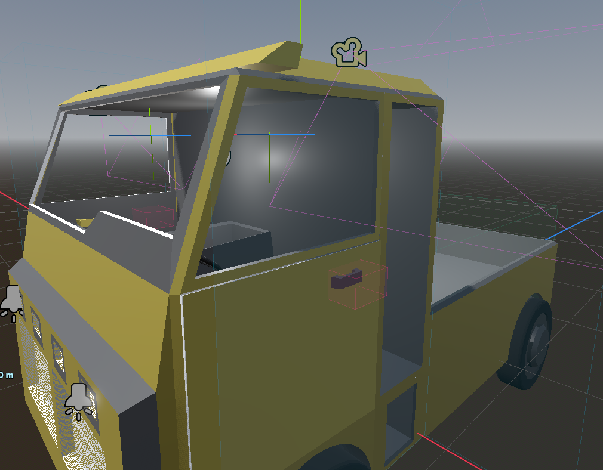
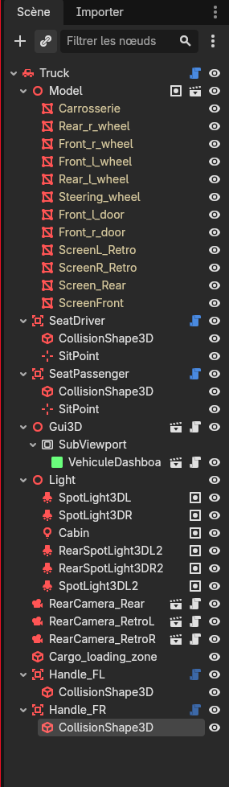
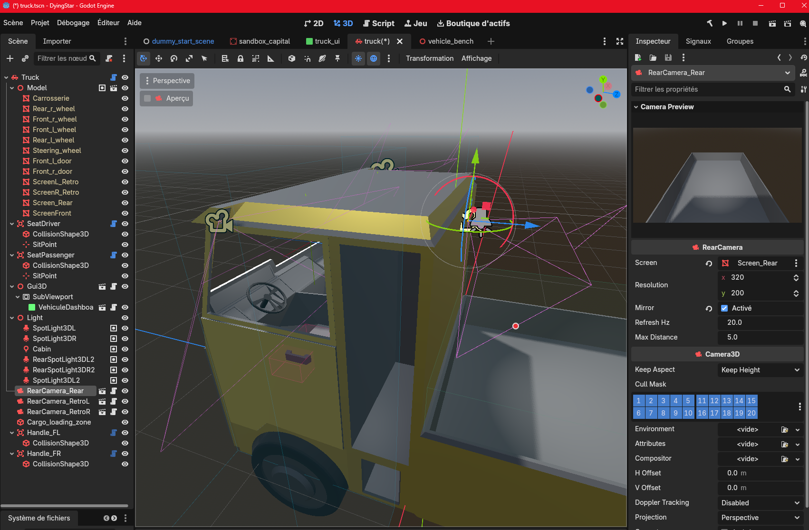

# Adding a vehicle

:::tip[New here? Read the overview first]
**[How DyingStar networking works](./intro.md)** explains the multiplayer basics in plain
language. This is a step-by-step build guide — but good news: most of the time a new vehicle is
just a **scene to assemble**, with little or no new code.
:::

This guide walks through creating a new drivable vehicle (truck, car, rover…). Vehicles are
server-authoritative networked props: the game server simulates the physics and replicates the
state to every client, exactly like the other props (see
[Props network management](./props.md)). A vehicle adds two things on top:
**driving** (a powertrain) and **seats** (driver / passengers).

All the moving parts already exist as reusable pieces — in most cases a new vehicle is just a
**scene** to assemble, not new code.

## The pieces

| Script | Role |
|---|---|
| `scenes/_universe/vehicles/vehicle.gd` (`class_name Vehicle`) | The vehicle base: body/wheels, physics, driving, networking, cargo. Put it on the scene root. |
| `scenes/_universe/vehicles/vehicle_powertrain.gd` | Engine math (electric / thermal gearbox). Owned by `Vehicle`, configured through its `@export`s — you don't touch it. |
| `scenes/vehicles/vehicle_seat.gd` (`class_name VehicleSeat`) | One seat (driver or passenger), boarded by looking at it. You drop one per seat. |
| `scenes/vehicles/vehicle_debug_hud.gd` | Optional on-screen dashboard (speed, RPM, load). |

## 1. Where to put the files

- **Scene**: `scenes/vehicles/<category>/<name>.tscn` (e.g. `scenes/vehicles/trucks/truck.tscn`).
- **Assets** (3D model, materials, textures): follow the project conventions in
  [Files structure](../creativeConcept/files_structure.md) and
  [3D models](../creativeConcept/3d_models.md). Do **not** invent a new layout.

## 2. Build the scene

Create a scene whose **root is a `VehicleBody3D`** and attach `vehicle.gd` to it.

You have two options for the body:

- **Real 3D model (GLB)** — instance the artist's `.glb` as a child of the root and add it to the
  group **`vehicle_model`**. That switches the procedural blockout **off** automatically (no flag),
  and `vehicle.gd` wires the model's parts **by name** at runtime: wheels, steering wheel and doors.
  See **[Using a real 3D model](#using-a-real-3d-model-glb)** below, and the modeler-facing
  [Vehicle 3D models](../creativeConcept/vehicle_models.md) page for the naming / pivot / UV rules.
- **Parametric blockout (placeholder)** — with no real model, `vehicle.gd` generates a box-built
  body, chassis collision, four wheels, cameras and the cargo bay from its exported dimensions
  (`@tool`, so it rebuilds live in the editor). Tune it via the **Body / Cab / Bed / Wheels** export
  groups, and carve the cab opening with **Cab → Cab Cutout Size / Offset**.

:::tip[Use the blockout to prototype a vehicle *before* the 3D model exists]
The blockout is not just a leftover — it's the **"design without a GLB yet"** path. A developer can
create a new vehicle (rover, car, bike…) and test **driving, physics, seats and cargo** right away,
while the 3D artist is still making the model. When the GLB lands, drop it in the `vehicle_model`
group and the blockout visual switches off — no code change. So keep it: removing it would force
every new vehicle to wait for a finished model.
:::

Either way, collision, cameras and the cargo bay are still built; only the **visual** body and the
procedural tires are skipped when a real model is present. The generated nodes are transient (no
owner), so the `.tscn` stays minimal — only the root, its script and your designer-placed nodes (the
seats, the GLB instance, door handles…) are saved.

### Scene layout at a glance

The finished truck — the artist's GLB body wrapped by the Godot **rig**:



Its scene tree — the GLB `Model` plus the rig nodes you add around it:



- **`Model`** (group `vehicle_model`) — the GLB: body, `*_wheel`s, `Steering_wheel`, `Front_*_door`s
  and the screen meshes. Everything **below** it is the rig you add in Godot.
- **`SeatDriver` / `SeatPassenger`** (`VehicleSeat`) — the seats, boarded by looking at them (§3).
- **`Gui3D → SubViewport →` dashboard UI** — the in-cab screen (§Dashboard).
- **`Light`** — the `vehicle_light` lamps (head / brake / cabin).
- **`RearCamera_*`** — reversing camera + mirrors (the middle one is the
  [switchable cab screen](#the-switchable-cab-screen)).
- **`MapMarker`** — how the truck shows on the star chart (see [Star map](../uiux/star_map.md)).
- **`HandleFL` / `HandleFR`** (`VehicleDoorHandle`) — the door handles (§Doors).

Note the handles are placed at the **root** (siblings of `Model`), each on its door's visible handle.
At runtime the code re-parents each one **under its door mesh** so it swings with the door.

:::note[Set the collision layer & mask on the rig nodes]
The `VehicleBody3D` root goes on the `vehicle` layer with Mask `MASK_SOLID` (world + player +
vehicle + prop). The **seats** and the **door handles** go on the `interactable` layer with
**Mask 0** (monitoring off — they are passive look-at targets; the scripts set it in `_ready`).
Seated, your interaction ray passes through the seats of your own vehicle, so it reaches the door
handles around you. Set these in the Inspector; see
[Collision layers & masks](./collision_layers.md) for the full picture and the truck as a worked
example.
:::

### Component bays

Drop a `VehicleComponentSlot` (a `Marker3D`) per hatch, aim it where the part should sit, and name
the hatch that guards it in `door_id`. The vehicle finds its own bays by type — no per-vehicle
wiring, and a new chassis just adds nodes. Full details on
[Vehicle components](./vehicle_components.md).

## 3. Add the seats

For each place, add a **`VehicleSeat`** node (an `Area3D` with `vehicle_seat.gd`) as a child of
the root, then give it two children:

```
Truck (VehicleBody3D, vehicle.gd)
├── SeatDriver      (Area3D, vehicle_seat.gd)   role = Driver
│   ├── CollisionShape3D (BoxShape3D)   ← the seat itself: the box you LOOK at to board
│   └── SitPoint (Marker3D)             ← where the occupant sits (driver: the camera eye)
└── SeatPassenger   (Area3D, vehicle_seat.gd)   role = Passenger
    ├── CollisionShape3D (BoxShape3D)
    └── SitPoint (Marker3D)
```

- **`role`** (inspector): `Driver` controls the vehicle (drive input + HUD); `Passenger` just
  rides along. Set this per seat.
- **The box** (`CollisionShape3D`): fit it to the seat itself, cushion and back, inside the cab
  (around 0.6 × 0.9 × 0.6 m, centred a little under the `SitPoint`). It is what the player **looks
  at** to board: through the open door, within reach of the interaction ray (3 m).
- **`SitPoint`** (`Marker3D`): where the occupant is seated. For the driver it is also the
  **camera eye**, so place it at head height inside the cab, facing forward (the vehicle's local
  `-Z`).

You don't wire anything: the `Vehicle` discovers its seats automatically. A seat is a **look-at
target**, like a door handle: on the `interactable` layer, never monitoring. You board the seat you
**look at** — not a patch of ground you stand on — so two seats side by side are never confused.
Looking at a seat shows `[E] Driver seat` / `[E] Passenger seat`; a taken seat shows `Driver seat
taken`, a shut door *"Open the door first (aim at the handle)"* (its handle box covers the seat
behind it, so it takes the aim first).

:::tip[The server checks reach and sight]
On `enter_vehicle` the server finds the seat the client named and refuses it unless the player's
eye is within `VehicleSeat.REACH_M` (4 m: the ray's 3 m plus one for latency) of the seat's box and
has a clear line of sight to it (the vehicle's own hull excepted, as for a door handle). The seat
boxes used to stand beside the cab and the server never asked: any client could sit in any truck
from anywhere.
::: The driver gets free mouse look while driving and exits
with **Y**; the prompt is hidden while seated, and on exit you are dropped beside the seat you used.

:::tip[Seats are server-authoritative]
A seat refuses a second occupant, and if a seated player disconnects the server frees their seat
automatically. The driver/passenger logic lives in the **networked** path — the only path there is.
:::

Every seat's occupancy is **replicated** to all clients (a `seats` map on the vehicle, alongside
`doors`), so a taken **passenger** seat shows as occupied too — not only the driver. Without it a
client couldn't tell a passenger seat was in use and would let two players appear to sit in the same
spot.

### Seated poses

A seated player plays a matching **animation**: the driver holds the wheel (`Driving`), a passenger
sits (`Sitting_Nodding`). Remotes see it because the seat state is replicated as a `seat:<role>:<n>`
event (and `unseat:<n>` on exit) — see [Character animation](./character_animation.md) and
[the event-field idiom](./player.md#the-action-field-one-shot-events). A tunable puppet offset lines
the sit pose up with the seat's `SitPoint`; it shifts the visible body only, so the driver's
first-person camera stays where the seat puts it.

## 4. Configure the chassis (the powertrain comes from the engines)

:::info[Performance is not typed in any more]
A vehicle has **no** `engine_power`, `max_speed_kmh` or `propulsion_type`. How hard it pulls, how
fast it goes and how steep a slope it climbs are **derived from the engines bolted into its bays** —
see [Vehicle components](./vehicle_components.md). Fit no engine and the vehicle cannot move and
cannot even be started.
:::

What still belongs to the chassis, in the **Chassis physics** export group: its transmission
(`pump_efficiency`, `hydraulic_efficiency`, `torque_factor`), its shape (`drag_coefficient`,
`frontal_area_m2`), its rolling resistance (`rolling_coefficient`, `rolling_factor`), the local
`air_density`, how many engines it will run (`max_engines`), what it leaves the works with
(`factory_components`), and its **bare** weight (`empty_mass` — modules and payload excluded).

Steering, brakes, wheels and suspension are unchanged, and so is **Cargo** (`max_payload`, overload)
for the load limiter.

You never edit `vehicle_powertrain.gd` — the `Vehicle` feeds it from `VehicleDriveSpec`, which is
rebuilt whenever a part is fitted or removed.

:::tip[Every knob]
See **[Inspector reference — every `@export`](#inspector-reference--every-export)** at the bottom of
this page for the full list of tunables (Drive, Steering, Body/Cab/Bed, Wheels, Real 3D model,
Electric, Thermal gearbox, Cargo, Debug) with their defaults.
:::

## 5. Register it on the network

A vehicle only replicates if the network layer knows it:

1. **Spawn registry** — add the scene path to `props_scene` in **both** `server/client.gd` and
   `server/server.gd`:

   ```
   'scenes/vehicles/<category>/<name>.tscn':
       preload('res://scenes/vehicles/<category>/<name>.tscn'),
   ```

   (These are plain string paths — if you ever **move** the scene, update them by hand; Godot's
   UID rename does not touch string paths.)

2. **Replication definition** — vehicles use the `vehicle` prop type, defined in
   `horizonserver/ds_genericprops/props/vehicle_def.json`, split across three channels by **how
   often each property actually changes**:

   | Zone | Rate | Properties |
   |---|---|---|
   | 0 | 30 Hz (LOD: 10 Hz past 100 m) | `position`, `rotation`, `pilot_uuid`, `steering`, `speed`, `handbrake`, `headlights`, `engine`, `doors`, `seats`, `components`, `limiter_on`, `limiter_kmh`, `cruise_on`, `cruise_kmh`, `rear_screen`, `chart_view` |
   | 1 | 1 Hz | `horn`, `horn_special`, `mass`, `cargo_mass`, `suspension`, `odometer_km` |
   | 6 | 1 Hz | `scenename`, `parent_id` |

   If you reuse the `vehicle` type, there is nothing to add. A brand-new type needs its own
   `<type>_def.json` — see [Replication definition files](./props.md#replication-definition-files).

### The replicated state, as the database holds it

Every key goes out **from the first tick**, with its value even when it is the default — an admin
reading the database sees `"headlights": false`, `"pilot_uuid": ""`, every door shut and every seat and
bay empty, not a missing key. `Vehicle.full_state()` builds it; the server sends only what changed
after that, and the whole state once more ~2 s after spawn (Horizon drops in silence an update for an
object it is still creating). The keys **inside** `seats`, `components` and `doors` are snake_case:

```json
"seats":      {"seat_driver": "", "seat_passenger": ""},
"components": {"slot_fl": "<engine uuid>", "slot_fr": "", "slot_rl": "", "slot_rr": ""},
"doors":      {"front_l_door": false, "front_r_door": false, "hatch_fl": false, …}
```

- Seat and bay keys are their **node names** (PascalCase, Godot's convention: `SeatDriver`, `SlotFL`)
  turned into snake_case by **`VehicleNetKey`**, used wherever a key is written or read back. An older
  save (`"SeatDriver"`, `"Slot_FL"`) reads back under the new key.
- `doors` holds **only the vehicle's own doors** (the `door_id`s of its handles): an unknown id sent by
  a client is refused, and an old key read from the database (a mesh name from before a rename) is
  dropped.
- A part's bay is its own `slot_id` (snake_case too), published when it is fitted and taken out.
- Node names on the vehicle scenes are checked by `test_vehicle_node_names.gd` (PascalCase only).

:::warning[Rebuild Horizon after touching a def]
A property (or a whole type) that is not whitelisted is dropped silently → the vehicle appears on
the server but is **invisible** to clients (`Object definition not found for type: …`). Add it to
the def and **rebuild Horizon**.
:::

## 6. Test

**In game (F5)** — spawn the vehicle, open a door, **look at the seat** behind it, **E** to board
as driver or passenger, drive, **Y** to leave.

:::note[The standalone bench is gone]
There used to be a `vehicle_bench.tscn` that drove a vehicle locally, with its own keyboard input,
its own chase camera and its own debug keys. Nobody used it, and it was a **second control path
that could disagree with the real one** — the kind of divergence you only notice when a bug appears
in game and not on the bench. Everything a driver can do now travels player to server, and F5 is
the only way to try a vehicle.
:::

## Using a real 3D model (GLB)

Instance the artist's `.glb` under the `VehicleBody3D` root and add it to the group
**`vehicle_model`**. The blockout visual turns off and `vehicle.gd` wires the parts **by name** at
runtime — every part is **optional** (one that isn't there is simply skipped). The naming / pivot /
UV rules the artist follows are on the [Vehicle 3D models](../creativeConcept/vehicle_models.md) page.

:::warning[Disable node-type name suffixes on the model import]
Godot's glTF import treats trailing tokens like `_wheel` / `-wheel` (also `-col`, `-rigid`…) as
**node-type suffixes**: a part named `Steering_wheel` is silently turned into a `VehicleWheel3D` and
**renamed** `Steering` (you'll see "VehicleWheel3D should be a child of a VehicleBody3D" warnings).
Our code builds the physics itself, so this is unwanted. On the `.glb` → **Import** tab, untick
**Nodes → Use Node Type Suffixes** (and **Use Name Suffixes**) and **Reimport**, so parts stay
plain `MeshInstance3D` with their full names.
:::

### Wheels (any number)
The game finds the wheel parts in the model — nodes already typed `VehicleWheel3D`, **or** plain
meshes whose name contains `wheel` — reads each position, and creates a **real physics wheel as a
direct child of the vehicle** there, reparenting the visual mesh onto it (so it rides the suspension,
steers and spins). Front vs rear comes from the name (`front`/`rear`), else the axle nearest the cab
steers. Tune in the **Wheels** + **Real 3D model** groups: `wheel_radius`, `suspension_rest`, and
`real_wheel_spin_axis` (flip it if wheels spin around the wrong axis).

### Steering wheel
A mesh named `steering_wheel` turns with the steering angle — cosmetic, it reuses the already-
replicated `steering` (nothing new on the wire). It spins around **`steering_wheel_axis`** in the mesh's
own local frame (so a tilted column still turns in-plane); `steering_wheel_ratio` sets the lock-to-lock
feel. Absent → no-op.

:::warning[The spin axis is usually `(0, 1, 0)`, not `(0, 0, 1)` — Blender Z-up → Godot Y-up]
The disc's normal (its spin axis) is `+Z` in Blender, but the glTF export converts **Z-up → Y-up**, so
in Godot that normal becomes local **`+Y`**. So `steering_wheel_axis` is typically **`(0, 1, 0)`** (use
`(0, -1, 0)` if it spins the wrong way); `(0, 0, 1)` makes it wobble around the vertical instead. For an
**angled column** this only holds if the tilt lives in the wheel's **object rotation, not baked into the
geometry** — see the [modeler page](../creativeConcept/vehicle_models.md): keep the disc flat in local
space, tilt the object, and **don't apply** that rotation.
:::

### Doors (server-authoritative) + handles
**State** — open/close is decided by the **server** and replicated to everyone via the `doors`
property (a `{door_id: open}` map), so it **must be whitelisted** in `vehicle_def.json` (step 5
above). On a change every client plays the Blender clip `<door_id>_open` / `<door_id>_close`; a door
with no clip falls back to a code hinge-swing on the mesh named `door_id` (about `door_hinge_axis`).

**Handles are placed in Godot** (like seats), not in the model. Per door:
1. Add a **`VehicleDoorHandle`** node (an `Area3D`) under the vehicle, on the door's **visible handle**.
2. Give it **two** small **`CollisionShape3D`** children — one on the door's **exterior** handle, one on
   the **interior** side (the handle you'd reach when seated). Place each box **just proud of the body
   surface** (see the sightline note below).
3. Set its exports:
   - **`Door Id`** — the door's mesh / clip prefix, in snake_case (e.g. `front_l_door`; the mesh is
     found whatever its case).
   - **`Outdoor Shape`** — the exterior box (used when interacting **on foot**). Drag the child in.
   - **`Indoor Shape`** — the interior box (used when interacting **seated**). Drag the child in.
   - **`Open Angle Deg`** — fallback swing angle (used when the door has no Blender clip).
   - **`Reverse`** — swing the other way (fallback) / play the clip backwards (anim). Two doors that
     should open outward need **opposite** `Reverse`.

The handle sits on the interact layer, so the player **looks at it** and presses **E** to toggle the
door — no proximity zone, no per-vehicle wiring. Prompt: `[E] Open door` / `[E] Close door`.

Operating a handle **on foot** also plays a short **reach-out gesture** on your character, replicated
to everyone (a non-wheel emote — see [Character animation](./character_animation.md)). A driver or
passenger toggling a door from **inside** does not.

:::tip[You can only operate the handle you can actually see]
The interaction is **server-authoritative** and side-aware, so you can't open a door through the
bodywork:
- The **box you aim at** must match your side — the **outdoor** box on foot, the **indoor** box when
  seated in that vehicle. Aiming at the far-side box (the one you couldn't reach) is ignored.
- That box must also have a **clear line of sight** — a foreign wall, the terrain or another vehicle
  in the way blocks it (the vehicle's *own* body doesn't count).

Because a vehicle's collision is a coarse **convex** hull that encloses both boxes, the sightline check
excludes the vehicle itself; the *side* of the box (outdoor vs indoor) is what distinguishes "I can see
this handle" from "it's on the far side". So place each box **proud of its surface** and assign the two
`Shape` exports. Leave them unassigned and the sightline gate is simply skipped (the door opens on look).
:::

:::tip[The handle rides the door automatically]
Place each handle where the door's handle is **when the door is shut**. At runtime the code re-parents
it **under its door mesh** (matched by `Door Id`), so the handle **swings with the door** — you can
look at it and press **E** whether the door is open or closed. (Without this, a handle left on the
body would stay at the shut position and the look-at ray would miss it once the door swings open.)
:::

**Door-gated seats — open the door before you can get in *or* out.** Set the **`Door Id`** export on
the **`VehicleSeat`** to the door that guards it (e.g. the driver seat → `front_l_door`). Then:
- **Open/close** the door (look at the handle + **E**) on foot **or while seated** — so a
  driver/passenger can close it from inside.
- **E boards only once that door is open.** A closed door shows *"Open the door first (aim at the
  handle)"* instead of the board prompt.
- **Y leaves only once that door is open** — symmetric with boarding, so you can't step out through a
  shut door.
- A seat with an empty `Door Id` boards / leaves directly (no gating).

**The wind shuts an open door.** Driving with a door open, the relative wind presses on it; past a
certain speed the door check gives way and the door slams (server-authoritative, replicated like any
door). The server checks it ten times a second on a moving vehicle (`DoorWind`): the dynamic
pressure ½·ρ·v² — with **ρ the air of the planet at the vehicle's altitude**
(`AtmosphereProfile.air_density`) — on the leaf as the flow sees it (area × sin of its opening
angle, a flat plate's drag 1.2), at half its width from the hinge, against the door check's torque.
**Nothing to set on a new vehicle** whose doors follow the naming: a door whose `door_id` ends with
**`_door`** (`front_l_door`) catches the wind, and its leaf (area, width) is **measured from its own
mesh** in the GLB; anything else (`hatch_fl`, a lid) does not. The **`VehicleDoorHandle`**'s group
*Wind* overrides it:

| Setting | Default | Meaning |
|---|---|---|
| `wind_area_m2` | -1 | Area of the leaf: **-1 = measured** (a `_door`) or none (anything else); **0 = never**; a value = that area. |
| `wind_shut_travel` | `(0, 0, -1)` | Direction of travel whose airflow pushes it shut: a door hinged at its front edge is shut by driving forward. |
| `wind_width_m` | -1 | Hinge to free edge (the push acts at half of it); -1 = measured with the area. |
| `wind_hold_nm` | 25 | What the door check holds before it gives way. Twice the hold, 1.41 times the speed. |

On Tarsis 3 the truck's cab doors (measured: 1.15 m², 0.84 m wide, open at 60°) go at about
**32 km/h at the reference sphere** (air 1.27 kg/m³) and **41 km/h in the villages** at 5130 m
(0.77 kg/m³). It stays on the server because a door is gameplay, not decoration: a shut door bars
boarding and leaving, and only the server decides doors. Simplifications: still air (no wind of its
own), a constant plate coefficient, no gust, no lee of the cab. The air's density needs the
atmosphere profiles to carry their pressure (`surface_pressure_pa`): regenerate them with the editor
menu **DyingStar ▸ Rebuild atmosphere profiles** after the system data changes; until then the
vehicle's `air_density` export (1.26) is used.

Both gates are **server-authoritative**: the client checks them for the prompt, but the server
re-checks on `enter_vehicle` / `exit_vehicle` and refuses through a shut door — and, to board, out of
reach or out of sight of the seat.

### Collision (from the model)
The collision is **generated by code**, never hand-placed in the `.tscn`. Two sources, in order:
1. **`col_*` meshes in the GLB** (preferred) — the artist ships low-poly **convex** volumes named
   `col_cab`, `col_bed_floor`, `col_bed_left`… (see the modeler page). Each becomes one convex collider
   (`create_convex_shape()`) placed where it sits, and the source mesh is **hidden** (editor *and*
   game); several pieces keep the bed hollow. This matches the real shape — a parametric box can't.
   We use **hand-authored convex pieces** rather than automatic convex *decomposition* on the body mesh
   on purpose: a few cubes are clean, cheap and predictable, whereas decomposition spits out many messy
   shapes. Check them at runtime with **Debug → Visible Collision Shapes**.
2. **Fallback boxes** — if the model has no `col_*` mesh, `vehicle.gd` builds the parametric chassis +
   bed boxes from the **Body / Cab / Bed** exports. With a real model these now **follow the model's
   placement** (so they sit under the body, not at the origin), but they remain a rough approximation —
   good for a blockout, not a finished model. Tune them with **Debug → Visible Collision Shapes**.

So: for a finished vehicle, author the collision in Blender (`col_*`); the boxes are just the
no-model-yet safety net.

:::note[col_ carry no weight, and don't shift the balance]
Collision pieces have **no mass** — in Godot a collision shape never adds weight (and the *visual*
meshes never affect physics at all; only collision shapes do). The vehicle's mass is `mass` (empty)
**+ occupants + cargo** only (`_refresh_mass`), so `col_*` never inflate the load.

They *would* normally affect the **center of mass** (a RigidBody auto-derives its COM from its
collision shapes — a big `col_cab` at the front would pull the COM forward and the truck would
nose-dive). To prevent that, `vehicle.gd` **pins the COM** to the **wheelbase centre** (average wheel
position) plus the **`Center Of Mass Offset`** export — so handling stays balanced no matter how the
collision was modeled. Lower its Y for roll stability, or shift Z for a front/rear weight bias.
:::

:::tip[See the collision — Debug → Visible Collision Shapes]
The generated colliders are invisible by default. To check them:

1. In the editor top menu: **Debug → Visible Collision Shapes** (FR: *Déboguer → Formes de collision
   visibles*) — a checkbox, leave it ticked.
2. **Run** the game (**F5**). It's a *runtime* overlay, so it must be enabled
   **before** running and only shows while the game runs.
3. The colliders draw as **cyan wireframes** over the truck. You should see your `col_*` shapes hug the
   body (and **no** oversized fallback box) — proof the model collision is in use. If you instead see
   one big box overhanging the model, your meshes aren't named `col_*` (so the fallback kicked in).
:::

### First-person view = the driver SitPoint
The in-cab camera sits on the **driver seat's `SitPoint`** (the same eye point used in game), so it
follows the real model — no blockout dependency. Place that `SitPoint` at head height in the cab,
facing forward (`-Z`).

## Cargo — loading the bed

The bed is **read off the model**, like the hatches: no zone to place by hand.

- **The bed box** — the box around every `col_bed*` collision piece of the GLB (`col_bed_floor`,
  `col_bed_left`, `col_bed_rear`…), raised by **`bed_headroom_m`** (0.4 m) above the side boards so a
  crate stacked proud of them, or put down reaching over from outside, still counts
  (`Vehicle._bay_box()` / the static, unit-tested `Vehicle.bay_box()`). That one box is where a dropped
  item **loads**, where settled loads are **scanned**, and the passive zone the player's detector
  overlaps to count their weight while standing in the bed.
- **Blockout fallback** — a model with no `col_bed*` piece uses `cargo_bay_size` / `cargo_bay_offset`.

:::note[`CargoLoadingZone` is gone]
The truck used to carry a hand-placed `CargoLoadingZone` box (and the `cargo_loading_zone` export)
beside the `cargo_bay` box: two boxes to keep in step with the model by hand. Both are replaced by the
model's own bed pieces. Checked by `test/unit/test_vehicle_bed_volume.gd`.
:::

The load counts toward `max_payload`, the overload limiter shown on the dashboard.

- **Loading** — carry a prop (a crate, a mined rock) and **drop it inside the bed box** —
  whether you stand in the bed *or* reach over from outside; where the carry placement ray puts the
  item (not your position) decides. The
  `[E]` prompt reads **`[E] Cargo`** when dropping would load it (it sticks) and **`[E] Drop`**
  otherwise. The carrier hands it to the truck: the prop is frozen, parented to the vehicle so it
  rides along, and its mass is folded into the load. The bed never polls — loading happens on drop.
- **Placed in the bay** — a loaded item is tucked **entirely inside** the `cargo_bay` (using its real
  collision bounds, so any size or off-centre pivot fits) and rested on the bed floor, even when
  dropped from far / over the rim.
- **A held prop passes through vehicles** while carried, so a held box can't shove or flip a much
  heavier truck — you load by dropping, not by ramming.
- **Retrieve** — aim at a loaded item and press **E** (`[E] Carry`); it leaves the load and goes
  into your hands, like any [carriable](./props.md#carriables-carry--drop).
- **What counts as load**:
  - the props locked in the bed — each prop's weight is its `RigidBody` **mass**;
  - **on-foot players** standing in the bed (their body mass), **plus whatever they hold** in their
    hands.
- **A mining rock's mass scales with its size**: a whole rock keeps the mass set on its scene
  `RigidBody` (the GameDesigner value); a cut piece weighs that scaled by its volume ratio (a half
  ≈ half, a quarter ≈ a quarter), so smaller pieces load the bed less.
- Over `max_payload` the HUD shows `OVERLOADED`; past `max_payload × overload_immobilize` the
  vehicle won't move. Another **vehicle** is never loaded as cargo (no swallowing a truck with a
  truck).
- **Rollover** — if the vehicle tips past `cargo_unlock_tilt_deg` (default 65°), the bed unlocks and
  spills its whole load (GDD: the lock releases past a certain inclination).

:::note[Riding a moving bed]
Standing in the bed adds the weight, but **walking** in a *moving* bed (riding it on foot) is not
supported yet — it needs client-side prediction. A moving truck currently leaves a walker behind.
:::

### How the load rides the truck (freeze mode)

A loaded crate must follow the truck **rigidly** — and it is a `RigidBody3D`, which the physics engine
places in **global** space, *not* by inheriting its parent's transform. So parenting a crate under the
truck is **not enough**; how it is frozen matters.

:::warning[Use FREEZE_MODE_KINEMATIC for a body riding a moving parent — never STATIC]
A frozen `RigidBody3D` has two modes:

- **`FREEZE_MODE_STATIC`** (the default for a frozen body) behaves like a `StaticBody`: the physics
  server keeps **rewriting its world transform every physics frame**. Under a moving parent it stays
  put in the world while the truck drives off — the *"cargo left behind at speed"* bug.
- **`FREEZE_MODE_KINEMATIC`** is *animatable*: the body **follows its node's transform**
  (`parent_global × local`), so as the truck moves, the crate rides with it.

The crate is set **KINEMATIC** on both sides: the server does it when it locks the crate, and each
client does it for the replica **derived from the parent** — when a prop is reparented under a
`Vehicle` it switches to KINEMATIC, and back to STATIC when it returns to the world (`PropNet.apply_ride_freeze_mode`). Nothing extra is replicated for this: the client reads it from `parent_id`, which already travels.
:::

On top of that, two pins keep it perfectly stuck:

- **Server pin** — each physics frame the vehicle re-asserts every locked crate's **constant local
  pose** in the bed (`_pin_locked_cargo`), so a KINEMATIC body can't drift relative to the moving
  truck. The replicated local position therefore stays constant.
- **Client pin** — each render frame the prop re-asserts that same local pose
  (`PropNet.ride_pin`), so the crate tracks the **render-interpolated** truck without stepping at the
  physics rate (which would jitter). A direct set, not a lerp.

:::note[Cargo debug envelope]
Turn on **Settings → General → Cargo debug** to draw a green envelope around every crate that is
*really* locked in a bed (i.e. reparented under the vehicle). An item merely resting loose in the bed
gets none — a quick way to tell "stuck" from "just sitting there".
:::

## Hand brake

Vehicles **spawn with the hand brake engaged** (parked), and the driver toggles it with a **long press
of Space under 3 km/h** (released by throttle). It holds the vehicle still on flat ground and slopes by
**braking the wheels and cancelling drift** — **not** by freezing the body (freezing a `VehicleBody3D`
collapses the wheel suspension, so the wheels sink into the ground). It **stays engaged after the
driver leaves**. A moving vehicle left with **no driver and no hand brake** coasts to a stop on its own
(it never keeps driving off). Shown on the HUD and on the dashboard.

## Head lights

Head lights are a **drop-in** like seats: add any **`Light3D`** (e.g. a `SpotLight3D` at the front
facing the vehicle's local `-Z`) to the group **`vehicle_light`** anywhere under the scene — no
code. The driver toggles them with **L**; the state is server-authoritative and replicated, so every
client sees them. Shown on the HUD (`[L] lights`) and on the dashboard. The truck ships with two
front SpotLights as the example.

`L` is **contextual**: it drives the **head lights** while seated as driver, and the player's
**flashlight** on foot — the two never fire at once.

## Steering

The steer keys are a **rate, not a position**: a tap turns the wheels a little, holding turns them
further, and **releasing leaves them where they are** — the driver builds a turn up in taps, the way
one feeds a real steering wheel through the hands. Pressing the opposite direction winds them back
(a bit faster, `steer_return_speed`).

While **rolling**, the wheels drift back to straight on their own (a real wheel's caster):
`steer_self_center_speed`, scaled by speed up to `steer_self_center_ref_kmh`. **Parked**, they keep
their angle. The speed-sensitive lock (`steer_speed_falloff_kmh` / `steer_min_ratio`) still applies,
and pulls a held angle back in as the vehicle speeds up.

The maths lives in `vehicle_steering.gd` (`VehicleSteering`, pure and unit-tested); the vehicle copies
its Steering exports (see the Inspector reference below) into it every tick, so they can be tuned
live. Nothing new on the wire: the client still sends the steer axis, the server integrates it, and
`steering` is replicated.

## Speed limiter

The driver turns it on/off with **T** and moves the limit by **5 km/h** with the **mouse wheel**
(between 5 km/h and `limiter_max_kmh`). The chosen limit is kept while the limiter is off, so **T**
brings the same one back. Server-authoritative: the client only asks (`vehicle_limiter`,
`vehicle_limiter_step`), the server checks that the sender is the pilot.

- **Under the limit**, it does nothing; over the last `limiter_taper_kmh` the engine eases off, so the
  vehicle settles on the limit instead of banging against it.
- **At the limit**, the engine stops pushing.
- **More than 1 km/h over it**, the throttle counts as **closed**, so the usual engine braking (the one
  of a released pedal) brings the vehicle back down. The air and the tyres
  ([VehicleResistance](#air-drag--rolling-resistance)) alone would take far too long to bring a truck
  that is already over the limit back down: switching the limiter on at 50 km/h with a 30 limit has to
  be felt at once.
- It **never adds a brake**: downhill the vehicle may still run over the limit; slowing down is the
  driver's job.

On the dashboard the limit is **dimmed** when the limiter is off, **green** when it is on, **red**
while it is holding the vehicle back. Replicated as `limiter_on` / `limiter_kmh` (and so persisted).

The wheel steps **whichever system holds the speed**: the cruise control while it is on, else the
limiter (on or off, so the limit can be set before it is used). The limiter and the cruise control are
**exclusive** — switching one on switches the other off (`PlayerServer`, actions `vehicle_limiter` and
`vehicle_cruise`): one caps the speed, the other sets it, and both at once would leave the driver
wondering which one holds the truck.

## Cruise control

`VehicleCruiseControl` (`scenes/_universe/vehicles/vehicle_cruise_control.gd`, a
[`VehicleNetPart`](#adding-replicated-vehicle-state--vehiclenetpart), exposed as `vehicle.cruise`).
**Ctrl + T** (action `vehicle_cruise_control`) switches it on **at the speed being driven**, rounded to
the km/h; the wheel then moves the set speed by one step. It shares the limiter's step and range
(`limiter_step_kmh`, `limiter_max_kmh`), and its lowest set speed is one step.

- **Hold**: with the pedal released the throttle is `(set_kmh − speed) × gain` (`gain` 0.3, clamped to
  0..1) — a proportional hold, like a real one: it settles a little under the set speed, by what the
  air and the slope need. It **never brakes**: at or over the set speed it only closes the throttle.
- **Never engages under `min_kmh`** — standing still or backing up included (the server passes the
  **signed** `Vehicle.forward_speed_kmh()`): a hold set there would drive a parked or reversing truck
  forward on its own.
- **What switches it off**: pressing the pedal either way (accelerating or braking), a reverse, the
  brake, the hand brake, the engine stopping, the driver leaving the seat (`server_exit`,
  `server_release_seat`), and the limiter being switched on. A pedal **already held** when Ctrl+T is
  pressed only counts once it has been let go, so Ctrl+T at speed with the foot still down does not undo
  itself (`drive_throttle`).
- Applied in `Vehicle._apply_drive`, **before** the hand brake's release: its throttle must never let a
  hand brake off.

Replicated as **`cruise_on`** / **`cruise_kmh`** (zone 0, so persisted). On the dashboard the speed
cell shows the cruise icon (`assets/_universe/vehicles/ui/dashboard_icons/cruise.png`) and the set
speed, in green, while it holds; the limiter's otherwise. Tests: `test/unit/test_vehicle_cruise_control.gd`.

## Air drag & rolling resistance

`VehicleBody3D` models neither the air nor the tyres' rolling resistance. Without them a truck at full
throttle needed no push at all to keep its speed, and its batteries stopped draining at top speed.
`VehicleResistance` (`scenes/_universe/vehicles/vehicle_resistance.gd`, static and pure) adds both as
**real forces**, applied in `Vehicle._integrate_forces` against the velocity — on the game server (or a
vehicle off the network simulating itself), never on a client replica:

| Force | Formula | Inputs |
|---|---|---|
| Air drag | ½·ρ·Cd·A·v² | ρ = `air_density_now()`, `drag_coefficient`, `frontal_area_m2` |
| Rolling resistance | Crr·m·g, faded in over the first 0.5 m/s | `rolling_coefficient × rolling_factor`, the body's `mass`, the local gravity; only while the driven wheels touch the ground |

- **ρ is the planet's**: `Vehicle.air_density_now()` reads the planet's `AtmosphereProfile` at the
  vehicle's altitude (`Planet.elevation_of`), falling back to the `air_density` export (1.26) when the
  profile carries no pressure or there is no planet. A truck runs freer up on the plateau and meets no
  air at all on an airless world. The drag and the drive model both ask for it every tick, so it is
  **read once per physics tick** (cached on `Engine.get_physics_frames()`); `VehicleComponentBays`
  hands the same value to `VehicleDriveSpec`.
- **The taper ends at the motor's own top speed** (`VehicleDriveSpec.v_max_motor_ms()`), not the air's:
  with drag a real force, a taper ending at the speed the air allows counted the air twice. Where the
  air holds the vehicle back first, that force alone stops it, below the taper. The motor pull is now
  the full `tractive_force_n()`; rolling resistance is no longer subtracted from it in advance.
- `engine_brake` is now the motor's braking alone, and `coast_drag` defaults to **0** (kept for a
  vehicle that wants more engine braking).

Tests: `test/unit/test_vehicle_resistance.gd`.

## Wheel speed sign

`Vehicle.get_wheel_kmh()` reads **positive forwards, negative in reverse**. Godot's `VehicleWheel3D.get_rpm()`
is positive rolling toward the body's **+Z**, and our vehicles drive toward **−Z**
(`_forward_speed_kmh`), so `_rolling_wheel_kmh()` negates it. Every reading used to take the absolute
value; the reversing camera is the first to read the sign. Anything new that needs the direction of
travel should read `get_wheel_kmh()` (wheels) or `forward_speed_kmh()` (body), never `get_rpm()` raw.

## Odometer

Every vehicle counts the distance it has driven **over its whole life** — across sessions and server
restarts. The server adds up the moves of the vehicle's **local** position (relative to the planet it
drives on, which moves and spins), and skips a step when the parent changes (new frame) or when it is
too long to have been driven (a reset, a teleport). It is replicated as `odometer_km` in 0.1 km
steps, only on change — and being replicated is what makes the persistence service store it. At boot
the server takes it back through the same restore path as the doors. Shown on the dashboard.

:::note[Known limitation]
If Horizon re-seeds a vehicle with a **new uuid**, that vehicle starts again from 0 km.
:::

### Adding replicated vehicle state — `VehicleNetPart`

The limiter, the odometer, the cruise control, the suspension shocks, the cab screen's mode and its
chart view are **parts** (`vehicle_net_part.gd`, listed in `Vehicle._net_parts()`): each one knows what it last sent,
writes only its **changed** keys (`write_changes`), and takes received keys back (`read`), remembering
them as sent so a value restored from the database is not sent straight back. `Vehicle` asks every
part in `_replicate_transform`, and hands every part the received data in `client_channel_data_update`
and `server_adopt_state` — so a new piece of vehicle state is **a new part**, not new lines in those
three functions. Parts are exposed as properties (`vehicle.limiter`, `vehicle.odometer`), not getters:
`vehicle.gd` sits two below gdlint's 40-public-method ceiling.

:::warning[Whitelist every new key — in both repositories, deployed together]
A key a part writes must also be listed in **two** copies of the vehicle def — Horizon drops anything
else in silence: no error, the value simply never reaches the other clients nor the database.

1. Write the part: `extends VehicleNetPart`, with `write_changes` (only changed keys), `read` (remember
   what was read as sent) and `forget_sent`; add it to `Vehicle._net_parts()`.
2. Add the key to the zone-0 list of `items_def/vehicle_def.json` in the **game** repository.
3. Add it to `ds_genericprops/props/vehicle_def.json` in **horizonserver**, in the same zone.
4. Rebuild and redeploy **`horizon-data`** (`build-and-deploy.ps1 horizon-data` in local dev): Horizon
   reads the defs from that image, and without the rebuild it keeps the old whitelist.

The two pull requests go out in **lockstep**: the cruise control and the cab screen
(`cruise_on`, `cruise_kmh`, `rear_screen`, `chart_view`) are game PR DyingStar#411 with
horizonserver#123.
:::

## Dashboard — optional in-cab screen

Show live data (speed, RPM, load…) on a screen in the cab using the generic 3D-screen pattern —
see **[GUI on a 3D screen](./in-3d-screen.md)** for the setup (SubViewport, ViewportTexture, and
the Local-to-Scene / viewport-path gotchas).

:::tip[Use a screen mesh from the model]
Point the `Gui3D`'s **`node_quad`** at a screen mesh in the GLB (e.g. `ScreenFront`, via *Editable
Children* on the model). `Gui3D` now applies its `SubViewport` as a texture **by code** when the mesh
has no `material_override` — so a model screen "just works", no hand-made ViewportTexture material.
The mesh still needs clean `0..1` UVs and its front face toward the driver (see the
[Vehicle 3D models](../creativeConcept/vehicle_models.md) screen rules). The dashboard is read-only,
so `node_area` (touch) is optional.
:::

The **vehicle-specific** part is only the UI script: put `vehicle_dashboard.gd`
(`VehicleDashboard`) on your UI scene's root. It finds its owning `Vehicle` in the tree and shows
the generic Vehicle data each frame (speed, RPM, load, overload, powertrain, transmission) — so it
is reusable by any vehicle, and the Vehicle knows nothing about it. Name the Labels `speed`,
`RPM`, `Load`, `Overloaded`, `Elec_THerm`, `Transmission`, `hanbreak`, `Light`, `Limiter`,
`Odometer` (or adjust them in the script).

## Rear-view camera & mirrors

A live camera feed on an in-cab screen — a **drop-in** (`scenes/_universe/vehicles/rear_camera.tscn`),
reusable and **client-only** (no render on the headless server). Use it for a reversing camera and
for side / rear-view mirrors (the GDD allows "mirrors **or** relayed cameras"). Godot has no cheap
real reflective surface, so a mirror is just a camera too.

Setting one up in the editor — select the `RearCamera`, frame it with the **Camera Preview**, and
drag the model's screen mesh into its **`screen`** slot:



**Setup** (no code):

1. Instance `rear_camera.tscn` under the vehicle.
2. `RearCamera` **is** a Camera3D — place and frame it in the editor (gizmo / **Preview**), at the
   back looking behind (or at a side mirror, looking back/outward). It never renders to the player's
   view; a twin camera inside its `SubViewport` (sharing the main `world_3d`) copies its pose + fov
   and renders the feed.
3. Set the `RearCamera`'s **`screen`** to the surface that shows the feed. Use either a local
   `MeshInstance3D` with a **`QuadMesh`**, **or a screen mesh from the GLB model** (e.g.
   `Recul_Screen`, `RetroL_Screen`, `RetroD_Screen`) — select it via *Editable Children* on the model
   and drag it into `screen`. The feed material is applied at runtime and is **one-sided** (shows on
   the front face only). A blank screen = the face points the wrong way → fix the **normals in
   Blender** (front face toward the driver — see the
   [Vehicle 3D models](../creativeConcept/vehicle_models.md) screen rules), and ensure clean `0..1`
   UVs. (The `mirror` flag below flips left/right; it does **not** fix a wrong-facing or rotated face.)
4. **`mirror`**: off = a reversing camera (true view); on = a mirror (reverses left/right).
5. **`resolution`**: match its aspect to the screen quad to avoid stretching.
6. **`max_distance`** / **`refresh_hz`**: see Performance below.

:::warning[Performance — each feed is a second full render]
Each `RearCamera` renders the whole world again, so a rear cam + two mirrors = three extra renders.
Two built-in limiters keep this cheap on weak GPUs (the screens still stay live for everyone):

- **`max_distance`** — beyond this distance from the viewer the feed stops rendering (keeps its last
  image; it is unreadable from afar anyway). `0` disables the distance cull.
- **`refresh_hz`** — how many times per second the feed re-renders (default 20, not the full frame
  rate). `0` renders every frame.

Also keep `resolution` small.
:::

### Screens power off with the engine

The rear-view screens **and** the dashboard go **dark without power**, and light up again on
ignition — so a parked truck reads as powered-down, not frozen. Power is one rule,
**`Vehicle.screens_powered()`**: the engine runs **and** the battery holds (`is_engine_on()` and
`energy.has_energy()`), read by the screens and by the server, which refuses to switch a dark screen.
Each screen reads it on its own (the `Vehicle` knows nothing about its screens): a rear camera swaps its
feed for a black image **and stops rendering** (no wasted GPU) while off, and the dashboard multiplies
its panel to black. Since the engine state is replicated, every nearby player sees the same on/off. No
setup — it's automatic on any screen wired as above.

### The switchable cab screen

A `RearCamera` with **`switchable`** on (the truck's middle screen) shows what the vehicle's
**`VehicleScreenMode`** says (`scenes/_universe/vehicles/vehicle_screen_mode.gd`, exposed as
`vehicle.screen_mode`), in the order the key cycles them:

| Mode | Shown |
|---|---|
| `OFF` (a new truck's) | **OFFLINE** under the logo of the ARES subsidiary that runs the vehicle (`brand`, `AresBrand`), drawn once on black |
| `MAP` | the **star chart** of the player looking at it — each seated player sees the chart of where *they* are |
| `CAMERA` | the camera feed |

Without power (`screens_powered()` false) it is dark whatever the mode. While the wheels turn
**backwards** the feed shows over any mode, as a real reversing camera does (`RearCamera.shown_for`,
`reverse_time_left`, both static and tested).

| `RearCamera` export | Default | Role |
|---|---|---|
| `switchable` | `false` | Off: always this camera's feed. On: the three modes above. |
| `map_resolution` | `(960, 600)` | Pixels of the chart (and of OFFLINE) on the screen. |
| `brand` | `HAULING` | The ARES subsidiary whose logo shows on OFFLINE. |
| `show_when_reversing` | `true` | Backing up shows the feed whatever the mode. |
| `reverse_min_kmh` | `0.5` | Wheels slower than this backwards are not reversing (a truck settling on a slope). Read from the signed [`get_wheel_kmh()`](#wheel-speed-sign). |
| `reverse_hold_s` | `2.0` | How long the feed stays after the wheels stop turning backwards, so a paused reverse does not flick the screen. |

**Switching it.** Anyone **seated** in the vehicle — driver or passenger, the screen is the cab's —
aims the crosshair at it and presses **F** (`action`); the prompt names the mode it goes to next. The
client sends the action **`vehicle_screen_mode`**; the server (`PlayerServer`, `_boarded_vehicle`) checks
the sender sits in that vehicle and that the screen has power, then calls `screen_mode.cycle()`. The mode
is a state of the vehicle, replicated as **`rear_screen`** (an int: 0 OFF, 1 MAP, 2 CAMERA), so everyone
aboard and a late joiner see the same.

**Pointing the chart.** `CabScreenPointer` (`scenes/player/cab_screen_pointer.gd`), fed every frame by
`PlayerClient` while seated, does three things:

- finds the vehicle's switchable screen (group `RearCamera.GROUP`, `cab_screen`) and whether the
  crosshair hits it, within `REACH_M` (4 m), through the screen's own `Gui3D` (`RearCamera.map_gui()`);
- in `MAP` mode, **hosts the player's own `StarMap`** in the screen's viewport (`map_slot()`, via
  `StarMap.host_in`) with `keys_live = false` — the keys and the pad stay the driver's — and sends it
  home to the DataPad when the mode changes, the player leaves the seat or the truck leaves the tree;
- while the crosshair is on the chart, sends it the hover and **every mouse button, the wheel included**
  (`input()` returns true, so the wheel does not also step the limiter).

The screen's mesh leans inside its own frame, so its `Gui3D` uses [`uv_frame`](./in-3d-screen.md#tilted-screen-meshes-uv_frame).

**A shared view.** `VehicleChartView` (`scenes/_universe/vehicles/vehicle_chart_view.gd`, exposed as
`vehicle.chart_view`) makes everyone aboard see the same chart view:

- The player who touched the chart counts as **handling it for 1.5 s after their last input**
  (`CabScreenPointer.HANDLING_S`). Meanwhile they send `StarMap.view_state()` with the action
  **`vehicle_chart_view`**, at most every 0.1 s and only when it changed; the others show the replicated
  view with `StarMap.show_view()`.
- The server accepts it only from a seated player and keeps a **cleaned** copy
  (`VehicleChartView.clean_view`): only the numbers `zoom`, `yaw`, `pitch`, `lean_turn`, `lean_angle`,
  `poi` (finite) and the names `watch`, `select` (strings cut to 64 characters). A client's dictionary is
  data, never trusted.
- Replicated as **`chart_view`** (a dictionary), sent only when it changed.

Tests: `test/unit/test_cab_screen.gd`.

## Inspector reference — every `@export`

Every knob below lives on the root **`Vehicle`** node, grouped in the Inspector exactly as shown.
Listed values are the **defaults** — `truck.tscn` overrides some of them. Most apply **live**.
Changing a **dimension** (Body / Cab / Bed / Wheels) rebuilds
the procedural blockout; with a real GLB model the blockout **visual** is skipped, but the collisions,
cameras and cargo bay still use these numbers.

### Drive

| Property | Default | Role |
|---|---|---|
| `torque_response` | `2.5` | How fast torque ramps to the throttle (1/s). Lower = gentler launch (keeps a heavy vehicle from leaping off the line). |
| `brake_force` | `30` | Brake force per wheel. |
| `engine_brake` | `6` | Engine braking applied per wheel while coasting (no throttle, no brake): the motor alone, the tyres and the air being real forces now ([VehicleResistance](#air-drag--rolling-resistance)). Keep well **below** `brake_force`. |
| `coast_drag` | `0` | Throttle released: share of the speed lost per second on top of `engine_brake`. It stood in for the drag the game did not model; kept for a vehicle that wants more engine braking. |
| `handbrake_hold` | `30` | Parking-brake damping (m/s per s) **above** the release speed. A real collision impulse exceeds this, so a hit parked truck still gets pushed (then re-settles). |
| `handbrake_release_speed` | `2` | Horizontal speed (m/s) **below** which the engaged hand brake fully cancels motion — a parked truck must not move from a player bump or a gentle slope. |
| `drive_mode` | `ALL` | Driven wheels: `FRONT` (FWD), `REAR` (RWD) or `ALL` (4×4). |
| **Mass** | *(node)* | Not an `@export`, and **not authored**: the vehicle writes it as `empty_mass + fitted components + cargo`. |
| `center_of_mass_offset` | `(0,0,0)` | COM offset (m) from the wheelbase centre. We pin it ourselves (else the `col_` pieces drag it forward → nose-dive). Lower Y for roll stability, shift Z for a weight bias. |

### Steering

| Property | Default | Role |
|---|---|---|
| `max_steer_deg` | `30` | Maximum front-wheel steering angle (degrees). |
| `steer_speed` | `1.6` | How fast a **held** key turns the wheels further (rad/s). Lower = more progressive (the truck uses `0.8`). |
| `steer_return_speed` | `3.0` | How fast a held key winds the wheels back when it points **against** the current angle (rad/s). |
| `steer_self_center_speed` | `0.3` | Hands-off drift back to centre while rolling (rad/s), reached at `steer_self_center_ref_kmh`. `0` = the wheels never move on their own. |
| `steer_self_center_ref_kmh` | `50` | Speed at which the hands-off drift reaches `steer_self_center_speed`; it scales linearly below. Parked = no drift. |
| `steer_speed_falloff_kmh` | `80` | Above this speed the steering lock shrinks (toward `steer_min_ratio`) — agile when slow, stable when fast. `0` disables. |
| `steer_min_ratio` | `0.35` | Fraction of the max steer angle still available at/above `steer_speed_falloff_kmh`. |

**Speed limiter** group:

| Property | Default | Role |
|---|---|---|
| `limiter_step_kmh` | `5` | One step of the selector (the wheel), km/h — the cruise control's step too, and its lowest set speed. |
| `limiter_max_kmh` | `130` | Highest selectable limit (and cruise speed), km/h. |
| `limiter_default_kmh` | `30` | Limit the selector starts on, km/h. |
| `limiter_taper_kmh` | `3` | The engine eases off over this many km/h below the limit. |

**Steering wheel (visual)** sub-group — cosmetic only, no effect on driving:

| Property | Default | Role |
|---|---|---|
| `steering_wheel_ratio` | `8.0` | Radians the volant turns per radian of front-wheel steer (real cars ~8–16 lock-to-lock). |
| `steering_wheel_axis` | `(0,0,1)` | The steering-wheel mesh's own **local** spin axis (its disc/column axis). Try a cardinal axis until the volant spins in-plane. See [Vehicle 3D models](../creativeConcept/vehicle_models.md). |

### Body / Cab / Bed (blockout dimensions, meters)

Only used by (and only editable on) the **procedural blockout** — a real GLB model replaces the visual.
Changing any of these rebuilds the blockout live.

| Property | Default | Role |
|---|---|---|
| `body_length` | `4.6` | Blockout body length. |
| `body_width` | `2.0` | Blockout body width. |
| `body_height` | `0.5` | Blockout body height. |
| `cab_length` | `1.5` | Blockout cab length. |
| `cab_height` | `1.9` | Blockout cab height. |
| `cab_cutout_size` | `(2.255, 0.969, 0.744)` | Windshield / door opening carved from the body (a CSG subtraction inside the body combiner). |
| `cab_cutout_offset` | `(-0.017, 1.454, -2.062)` | Position of that cutout. |
| `bed_wall_height` | `0.7` | Blockout bed wall height. |

### Wheels

| Property | Default | Role |
|---|---|---|
| `wheel_radius` | `0.55` | Wheel radius (blockout + physics contact). |
| `wheel_width` | `0.35` | Blockout wheel width. |
| `wheel_visual_drop` | `0.5` *(0–1.5)* | **Client replica only**: drops the wheel meshes to ~ground level (a replica has no physics, so `VehicleWheel3D` never lowers them). Tune so the replica's wheels touch. |
| `wheelbase` | `3.0` | Distance between front and rear axles. |
| `track_width` | `1.55` | Distance between left and right wheels. |
| `suspension_rest` | `0.4` | Suspension rest length (how far the wheel hangs below its mount) → ride height. |
| `suspension_stiffness` | `22` | Spring stiffness (a 1 t truck ~20–25). Too high + any ground penetration launches the body. |
| `suspension_max_force` | `15000` | Max force each suspension can push (N). Must exceed the loaded static load per wheel (~5600 N at 2.3 t) with margin, or the bed bottoms out when full. |

### Real 3D model (GLB drop-ins)

Optional — present a GLB (group `vehicle_model`, or named wheel meshes) and the blockout visual is skipped.

| Property | Default | Role |
|---|---|---|
| `real_wheel_spin_axis` | `(1,0,0)` | Spin axis of a real wheel mesh, **in the mesh's local space** (its axle). A Blender +Y-up export with transforms applied usually leaves the axle on local X. Change if the wheels spin around the wrong axis (e.g. "on their edge"). |
| `door_open_angle_deg` | `75` | **Fallback only** (door with no Blender animation clip): instant open angle (degrees)… |
| `door_hinge_axis` | `(0,1,0)` | …about this local hinge axis. The real swing is normally authored in Blender. |

### Chassis physics

The chassis's own contribution to the drive model. The motor side of it lives on the **component**
(`power_w`, `torque_nm`, `efficiency`, propulsion, gearbox) — see
[Vehicle components](./vehicle_components.md).

| Property | Default | Role |
|---|---|---|
| `empty_mass` | `1425` | Mass of the **bare** chassis (kg), modules and payload excluded. Declared, never captured from `mass` at `_ready` — see the warning on the components page. |
| `max_engines` | `3` | How many engines this chassis will run. Bays are generic; the **chassis** caps the count. `-1` = no limit. |
| `factory_components` | *(empty)* | What the chassis leaves the works with (engines, batteries…). The server turns each entry into a **real, removable part** in a free bay, with a deterministic uuid so a restart upserts instead of duplicating. |
| `pump_efficiency` | `0.8` | Hydraulic pump efficiency — part of the chassis transmission, not of the motor. |
| `hydraulic_efficiency` | `0.8` | Hydraulic circuit efficiency. `pump × hydraulic` = 0.64 on the MVP truck. |
| `torque_factor` | `1.0` | Chassis torque multiplier applied to the sum of the motor torques. **No efficiency term** on this path — that is the design sheet's own rule. |
| `rolling_coefficient` | `0.01` | `Cr`, rolling resistance, applied as a force (`VehicleResistance`). The sheet quotes 0.001 on good tarmac to 0.3 on soft sand; per-surface `Cr` is a natural follow-up. |
| `rolling_factor` | `1.0` | Chassis multiplier on `Cr`. |
| `drag_coefficient` | `1.0` | `Cx`, in the air drag force ½·ρ·Cx·S·v² (`VehicleResistance`). |
| `frontal_area_m2` | `3.0` | `S`, frontal area, in the same force. |
| `air_density` | `1.26` | **Fallback** air density (kg/m³), used when the planet's atmosphere cannot say (no planet, or a profile without its pressure). Otherwise `air_density_now()` reads the planet's `AtmosphereProfile` at the vehicle's altitude. |
| `reverse_max_ratio` | `0.15` | Reverse top speed as a **fraction** of the forward top speed. A fraction, not a km/h, so it cannot contradict whatever engines are fitted. |
| `speed_taper_kmh` | `10` | Width of the band below the **motor's own** top speed over which the drive tapers off — the motor reaching its top revs. The sheet is an **equilibrium** model, not a torque curve: used as one it has no constant-power region, so the force would fall from 100 % to 0 in 0.1 km/h. The air usually settles the speed just before the band, the motors still pushing. |

:::note[Aerodynamic drag is simulated]
Air drag and rolling resistance are real forces since the 2026-10-19 playtest — see
[Air drag & rolling resistance](#air-drag--rolling-resistance). The motors push, and draw power, at a
steady top speed.
:::

### Cargo

| Property | Default | Role |
|---|---|---|
| `max_payload` | `1300` | Max payload (kg) before **overloaded** (load limiter). ⚠️ A fitted component is **not** payload: its mass counts towards the vehicle, or a truck could be immobilised for being overloaded by its own engines. |
| `overload_immobilize` | `1.2` | Above `max_payload × this` the vehicle is immobilized (1.2 = +20 %). |
| `cargo_bay_size` | `(2.0, 1.5, 3.1)` | Size of the cargo-bay box — **only** for a vehicle whose model has no `col_bed*` piece (a blockout); a real model's bed is read off those pieces. A massive body that comes to rest inside is absorbed (its mass added once). |
| `cargo_bay_offset` | `(0.0, 1.0, 0.75)` | Centre of that fallback box, relative to the vehicle origin. |
| `bed_headroom_m` | `0.4` | How far above the top of the side boards (m) a load still counts as in the bed: a crate stacked proud of them, or put down reaching over from outside. |
| `cargo_settle_speed` | `0.6` | A dropped body locks into the bed once it slows below this (m/s). |
| `cargo_unlock_tilt_deg` | `65` | Tilt (° from upright) past which the bed unlocks and spills its load (a rollover drops the cargo). `0` disables. |
| `debug_show_cargo_bay` | `true` | Show a translucent box marking the cargo-bay zone (turn **off** on shipped vehicles). |

### Debug

| Property | Default | Role |
|---|---|---|
| `debug_color_driven_wheels` | `true` | Tint the driven wheels green (idle wheels stay dark) to see FWD / RWD / 4×4 at a glance (turn **off** on shipped vehicles). |
